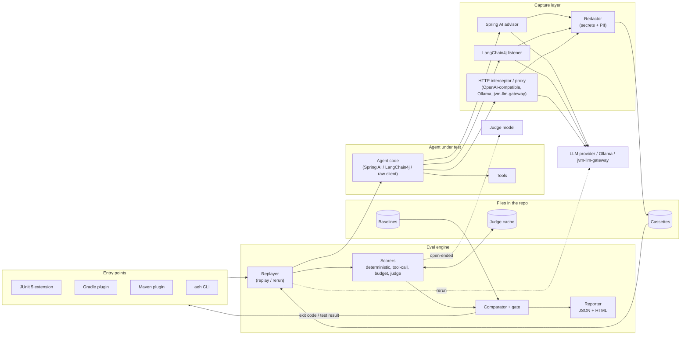

# agent-eval-harness

JVM framework that records LLM agent runs, replays them without the network, scores the results, and fails CI when quality regresses against a committed baseline.

It is test infrastructure. It is not an agent framework and not an LLM gateway. Copyright 2026 Gautam Gupta. Licensed under the [Apache License, Version 2.0](LICENSE).

**Status:** week 1 of the [six-week plan](docs/sdr/SDR-0001-agent-eval-harness.md#11-build-plan-6-weeks-one-reviewed-pr-per-week). The data model, price table, redaction, and `aeh lint` core are in place. Capture, replay, scorers, the JUnit 5 extension, the judge, the plugins, and reports are later weeks. Placeholder modules compile so those boundaries stay open.

## Architecture



The diagram is the one in [SDR-0001 §9.1](docs/sdr/SDR-0001-agent-eval-harness.md). Binding decisions are the [ADRs](docs/adr/README.md).

## Build

Requires a JDK 21 toolchain. Library modules compile with `--release 17`. The example module compiles with `--release 21`.

```bash
./gradlew build
./gradlew test
./gradlew :aeh-cli:run --args="lint path/to/file.json"
```

`./gradlew build` runs tests, Spotless, JaCoCo, and the license check. `aeh lint` exits 0 when clean, 2 on usage errors, and 3 when a secret or PII pattern is still present. Placeholders such as `<EMAIL_1>` are ignored.

Group id `io.github.guptagautam768`. Artifact ids use the `aeh-` prefix. Version `0.1.0-SNAPSHOT` is not published.

## Layout

| Module | Week 1 |
|---|---|
| `aeh-core` | Cassette, baseline, eval case, result, report, and price-table model. JSON I/O with `schemaVersion` 1.0, stable key order, and atomic writes. Schemas live in [`schemas/`](schemas). |
| `aeh-redact` | Secrets and PII replaced with typed placeholders (`<EMAIL_1>`, `<SECRET_2>`). Same value, same number, within one cassette. |
| `aeh-cli` | `aeh lint` only. Other commands arrive with the engine. |
| `aeh-engine`, `aeh-judge`, `aeh-report`, `aeh-junit5`, `aeh-http`, `aeh-spring-ai`, `aeh-langchain4j`, `aeh-gradle-plugin`, `aeh-maven-plugin` | Compile-only placeholders. |
| `aeh-bom` | Version alignment for the modules above. |
| `examples/spring-ai-support-agent` | Placeholder. The customer-support demo is week 2. |

Default file layout for later weeks, from the ADRs: `src/test/resources/aeh/cassettes/<suite>/<caseId>.json` and `src/test/resources/aeh/baselines/<suite>.baseline.json`.

## Roadmap

| Week | Scope |
|---|---|
| 2 | HTTP and Spring AI capture, replay, request matching, example agent recorded against Ollama |
| 3 | Deterministic, tool-call, and budget scorers; JUnit 5 extension; JSON report |
| 4 | Judge, re-run mode, baselines, gate, promote |
| 5 | Gradle plugin, Maven plugin, full CLI, HTML report, LangChain4j |
| 6 | Anthropic shape, cost ceiling, measured performance, docs, publishing setup |

Details and exit criteria: [SDR-0001 §11](docs/sdr/SDR-0001-agent-eval-harness.md#11-build-plan-6-weeks-one-reviewed-pr-per-week).

## Security

Redaction runs in memory before a cassette is written. It is best-effort regex and checksum detection, not a compliance guarantee. Names and free-text addresses are not detected. Review a cassette before its first commit. `aeh lint` is the gate that fails CI if something slips through. Provider keys belong in the environment, never in the repo.

The built-in price table prices the pinned local Ollama models at zero. Cloud prices are supplied by the user. Cost figures are estimates, not invoices.

## Specifications

- [SDR-0001](docs/sdr/SDR-0001-agent-eval-harness.md) — requirements, approved v1.0
- [ADR index](docs/adr/README.md) — ADR-0001 through ADR-0013 accepted; ADR-0014 proposed with this PR
- [Contributing](CONTRIBUTING.md)
