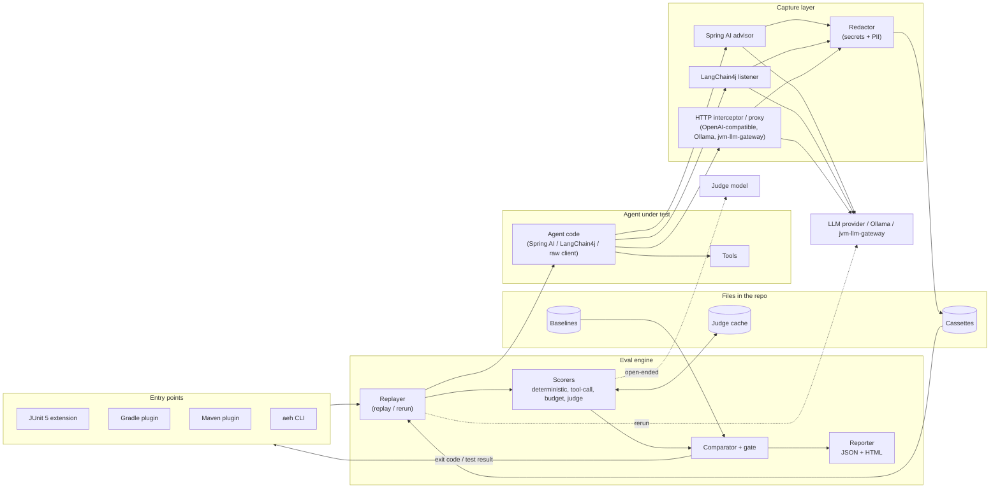

# SDR-0001: Agent Eval Harness: Software Design Requirements

| Field | Value |
|---|---|
| **Document ID** | SDR-0001 |
| **Title** | Agent Eval Harness: Software Design Requirements |
| **Status** | APPROVED |
| **Version** | 1.0 |
| **Author** | Grok Bot (for Gautam Gupta) |
| **Date** | 12 Nov 2026 IST |
| **Audience** | Gautam Gupta (owner / reviewer), future collaborators, portfolio readers |
| **Next gate** | ADR set (Proposed) → ADR review → implementation |
| **Related repos** | Complements `jvm-llm-gateway` (LLM access platform) and `resume-jd-matcher` (RAG + MCP app). This project is **test infrastructure for LLM agents**; it must not become another gateway or another agent app. |
| **Repo** | `agent-eval-harness`, public, under `guptagautam768` (RD-001). **Not created yet**; created only when Gautam gives the word. |
| **License** | Apache-2.0 (RD-002) |

---

## 1. Purpose and problem statement

### 1.1 Purpose

Define the **requirements** for an open-source, JVM-based **evaluation harness for LLM agents**: a library plus build tooling that records real agent runs, replays them against changed prompts or models, scores the results, and fails CI when quality regresses against a baseline.

This document is mainly a requirements specification. Section 9 sketches an **indicative** architecture and module layout so the requirements can be reviewed in context; the binding choices (module boundaries, file format, judge strategy, plugin mechanics) belong in ADRs after this SDR is approved.

### 1.2 Problem statement

JVM teams shipping agents (Spring AI, LangChain4j, or hand-rolled OpenAI/Anthropic clients) usually test them in one of three weak ways: manual spot checks in a chat window, brittle string-equality unit tests, or not at all. The result is:

- **Silent regressions.** A prompt tweak, model upgrade, or tool-schema change breaks behaviour and nobody notices until users do.
- **Non-reproducible failures.** Agent runs are non-deterministic and depend on live tools; a bad run cannot be replayed to debug or to guard against.
- **Untracked cost and latency drift.** A "better" prompt that doubles tokens or adds two tool hops ships unnoticed.
- **No tool-call correctness signal.** Agents that call the wrong tool, with wrong arguments, or in the wrong order, can still produce plausible final text.
- **Python-first tooling.** Most mature eval tooling lives in the Python/TypeScript ecosystem, so JVM teams either context-switch or skip evals. (Positioning statement only; no market or adoption figures are claimed.)

`agent-eval-harness` must let a JVM team treat agent quality like any other tested property: record once, replay deterministically, score with a mix of deterministic checks and LLM-as-judge, compare against a committed baseline, and gate the build.

### 1.3 Why this project (portfolio context)

It demonstrates Staff-level thinking about **production AI quality**: reproducibility, statistical noise, cost governance, privacy of recorded data, and developer-experience integration (JUnit, Gradle, Maven, CI). It pairs naturally with `jvm-llm-gateway` (the gateway can be a recording source and a replay target) without duplicating it.

---

## 2. Goals and non-goals

### 2.1 Goals (MVP)

| ID | Goal |
|---|---|
| G-001 | **Record** real agent runs (prompts, model params, LLM responses, tool calls and results, tokens, estimated cost, latency) into versioned, human-diffable files ("cassettes"). |
| G-002 | **Replay** recordings deterministically (no network, no paid keys) and **re-run** them against a new prompt, model, or agent version with recorded tool results served as stubs. |
| G-003 | **Score** runs on accuracy, tool-call correctness, cost and latency, using deterministic assertions, structured checks, and LLM-as-judge rubrics. |
| G-004 | **Compare** a candidate run set to a committed **baseline** and report per-case and aggregate deltas. |
| G-005 | **Gate CI**: fail the build when configured metrics regress beyond tolerance. |
| G-006 | Offer three entry points: a **JUnit 5 extension**, a **Gradle plugin**, a **Maven plugin** (RD-008), and a **CLI**. |
| G-007 | Integrate with **Spring AI** and a **raw OpenAI-compatible HTTP client** in MVP; **LangChain4j** (Should, week 5), **Anthropic** native (Should, week 6), and **jvm-llm-gateway** metadata (Could) (RD-006). |
| G-008 | Produce a **JSON report** (machine-readable) and a **self-contained HTML report** (human-readable). |
| G-009 | **Redact secrets and PII** at record time so cassettes are safe to commit. |
| G-010 | Ship a **zero-cost local path**: sample agent + Ollama for live runs; replay and deterministic scoring need no model at all. |
| G-011 | Be **recruiter- and interview-ready**: SDR → ADRs → weekly PRs, tests, CI, clear docs and a runnable demo. |

### 2.2 Non-goals (MVP)

| ID | Non-goal | Rationale |
|---|---|---|
| NG-001 | **Hosted SaaS / web dashboard / multi-user server** | Files + static HTML report are enough; a server is a later phase. |
| NG-002 | **Agent framework** | We test agents; we do not provide a new way to build them. |
| NG-003 | **LLM gateway, routing, or caching** | That is `jvm-llm-gateway`'s job. |
| NG-004 | **Production online monitoring / tracing backend** | Offline and CI evaluation only. OTel export is a future phase. |
| NG-005 | **Training, fine-tuning, or dataset generation at scale** | Synthetic case generation is a future phase. |
| NG-006 | **Statistically rigorous research benchmarking** | We provide practical noise controls (samples, tolerances), not a research-grade stats suite. |
| NG-007 | **Invoice-grade cost accuracy** | Cost is estimated from a configurable price table, as in `jvm-llm-gateway`. |
| NG-008 | **Non-JVM SDKs** | The CLI can score any cassette, but language integrations are JVM only. |

---

## 3. Personas and use cases

### 3.1 Personas

| ID | Persona | Needs |
|---|---|---|
| P-001 | **Agent developer** | Write eval cases next to unit tests; replay a bad run locally; see why a case failed. |
| P-002 | **Platform / Staff engineer** | A standard eval gate across teams; baselines in git; cost and latency budgets enforced. |
| P-003 | **CI / release owner** | Deterministic, fast default CI path; clear exit codes; reports as build artifacts. |
| P-004 | **Security / compliance reviewer** | Confidence that recordings committed to git contain no secrets or raw PII; judge calls don't leak data. |
| P-005 | **Portfolio reviewer / hiring manager** | Readable requirements → ADRs → working code trail; Staff-level trade-offs visible in docs. |

### 3.2 Use cases

| ID | Use case | Actor | Summary | Priority |
|---|---|---|---|---|
| UC-001 | Record a run | P-001 | Run the agent once against a live model with recording enabled; a redacted cassette is written. | Must |
| UC-002 | Deterministic replay in CI | P-003 | Replay cassettes with no network; agent code under test receives recorded LLM and tool responses; checks run. | Must |
| UC-003 | Re-run with a new prompt or model | P-001, P-002 | Re-execute recorded cases against a candidate prompt/model; tool results served from the cassette; score and compare to baseline. | Must |
| UC-004 | Tool-call correctness | P-001 | Assert the agent called the expected tools with expected arguments (exact, subset, JSONPath, or schema) in the expected order mode. | Must |
| UC-005 | LLM-as-judge scoring | P-001, P-002 | Score open-ended answers against a rubric with a configured judge model; record the judge's score and rationale. | Must |
| UC-006 | Regression gate | P-002, P-003 | Build fails when accuracy drops, tool-call correctness drops, or cost/latency rise beyond configured tolerance vs baseline. | Must |
| UC-007 | Update baseline | P-001 | Explicit command promotes the latest candidate results to the new baseline; diff is reviewable in the PR. | Must |
| UC-008 | Read a report | P-001, P-005 | Open the HTML report: summary, per-case diffs, tool-call timeline, judge rationale, cost/latency deltas. | Must |
| UC-009 | Record through jvm-llm-gateway | P-002 | Point the agent at the gateway; the harness captures calls and attaches gateway usage metadata where available. | Should |
| UC-010 | Score external cassettes via CLI | P-003 | Run `aeh` CLI on a cassette directory without a Gradle/Maven build. | Should |

---

## 4. Functional requirements

Requirements use MoSCoW priority: **Must** / **Should** / **Could**.

### 4.1 Recording

| ID | Requirement | Priority |
|---|---|---|
| FR-001 | The harness SHALL capture each LLM call in a run: provider, model, request parameters (temperature, max tokens, tool/function schemas), input messages, output messages, finish reason, token usage, latency, and error (if any). | Must |
| FR-002 | The harness SHALL capture each tool call: tool name, arguments (JSON), result (JSON or text), latency, error, and its link to the LLM call that requested it. | Must |
| FR-003 | Recordings SHALL be written as versioned, deterministic, pretty-printed text files (pretty-printed JSON, one file per case, stable key order; RD-005) so diffs are reviewable. | Must |
| FR-004 | Recording SHALL be possible via (a) framework integration hooks (Spring AI advisor / LangChain4j listener), and (b) an HTTP-level interceptor for OpenAI-compatible clients. | Must |
| FR-005 | Estimated cost SHALL be computed from a configurable price table (model → $/1K input and output tokens); missing prices record tokens with null cost and a warning. | Must |
| FR-006 | Recording SHALL apply secret and PII redaction **before** any byte is written to disk (see §8). | Must |
| FR-007 | Recording mode SHALL be explicit (`record`, `replay`, `rerun`, `live`); the default in CI SHALL be `replay`. A missing cassette in `replay` mode SHALL fail the case, never silently go live. | Must |

### 4.2 Replay and re-run

| ID | Requirement | Priority |
|---|---|---|
| FR-010 | **Replay** mode SHALL serve recorded LLM responses and tool results to the agent under test with no network access, matching requests by a documented key (call order plus normalized request hash). | Must |
| FR-011 | On request mismatch in replay mode the harness SHALL fail with a readable diff of expected vs actual request. | Must |
| FR-012 | **Re-run** mode SHALL call a live (or local Ollama) model with the candidate prompt/model, while serving tool results from the cassette when tool name + arguments match. | Must |
| FR-013 | In re-run mode, an unmatched tool call SHALL follow a configurable policy: `fail` (default), `live` (call the real tool), or `stub` (return a configured fixture). | Must |
| FR-014 | Re-run SHALL support N samples per case (configurable; default **3** for re-run, **1** for replay, RD-012) to expose non-determinism; results record all samples and an aggregate. | Should |
| FR-015 | Overrides for re-run (model, prompt template version, temperature) SHALL be configurable per suite and per case. | Must |

### 4.3 Scoring

| ID | Requirement | Priority |
|---|---|---|
| FR-020 | **Deterministic checks** SHALL include: equals, contains / not-contains, regex, JSON-schema validation, JSONPath assertions, numeric tolerance, and custom Java predicates. | Must |
| FR-021 | **Tool-call checks** SHALL include: expected tool set, forbidden tools, call count bounds, argument matching (exact / subset / JSONPath / schema), and order mode (`strict`, `in-order-with-gaps`, `any-order`). | Must |
| FR-022 | **LLM-as-judge** SHALL score against a named rubric with a numeric scale and return score + short rationale; judge model, prompt template version, and temperature SHALL be recorded with the result. Default judge is a local Ollama model; an OpenAI judge is optional via env (RD-011). | Must |
| FR-023 | Judge results SHALL be **cached** by (rubric version, judge model, input hash, output hash) so replays do not re-pay for unchanged judgements. | Must |
| FR-024 | **Pairwise judge** mode (candidate vs baseline answer, position-swapped to reduce order bias) SHALL be available. | Should |
| FR-025 | **Budget checks** SHALL assert per-case and per-suite limits on tokens, estimated cost, latency, and number of LLM/tool steps. | Must |
| FR-026 | Each case SHALL produce named metric values; each suite SHALL aggregate them (mean, pass rate, and p50/p95 for latency). | Must |
| FR-027 | Scorers SHALL be pluggable through a public Java SPI. | Must |

### 4.4 Baselines and regression gate

| ID | Requirement | Priority |
|---|---|---|
| FR-030 | A **baseline** file per suite SHALL store per-case and aggregate metric values plus the configuration that produced them. | Must |
| FR-031 | Gate rules SHALL be declarative per metric: direction (higher/lower is better), absolute floor/ceiling, and allowed regression tolerance vs baseline (absolute or %). Defaults (RD-013): pass_rate and tool_call_score −0.02 absolute; cost and tokens +10%; latency p95 +20%; judge score −0.05 (warn only). Judge metrics are Should (warn) gates by default; deterministic, tool-call and budget metrics are Must (fail) gates (RD-007). | Must |
| FR-032 | The gate SHALL fail the build (non-zero exit / failing test) when any **Must** gate rule is violated, and SHALL list each violation with case id, metric, baseline, candidate, and tolerance. | Must |
| FR-033 | Baseline promotion SHALL be an explicit action (`aeh baseline promote` / Gradle task); it SHALL never happen automatically in CI. | Must |
| FR-034 | Cases may be tagged (e.g. `smoke`, `nightly`) and suites filtered by tag. | Should |

### 4.5 CI integration and entry points

| ID | Requirement | Priority |
|---|---|---|
| FR-040 | **JUnit 5 extension**: annotations to declare an eval case or suite, bind a cassette, choose mode, and attach scorers; failures surface as normal test failures. | Must |
| FR-041 | **Gradle plugin**: tasks to run suites, compare to baseline, promote baseline, and render reports; configuration via a typed extension. | Must |
| FR-042 | **Maven plugin** with equivalent goals (thin wrapper over the same engine), in v1.0; may slip to v1.1 if week 5 overruns, with the CLI covering Maven users meanwhile (RD-008). | Should |
| FR-043 | **CLI** (`aeh`): `run`, `compare`, `report`, `baseline promote`, `lint` (cassette secret/PII scan); documented exit codes (0 pass, 1 gate failed, 2 config/usage error, 3 cassette integrity/redaction violation). | Must |
| FR-044 | A sample **GitHub Actions** workflow SHALL run the replay suite on PRs and upload the HTML/JSON report as an artifact, and write a summary to the job summary. | Must |
| FR-045 | JUnit XML output for CI systems that parse it. | Should |
| FR-046 | Optional PR comment with the gate summary (via a documented Action step). | Could |

### 4.6 Integrations

| ID | Requirement | Priority |
|---|---|---|
| FR-050 | **Spring AI**: record and replay `ChatClient` calls including tool calling, via an advisor/interceptor, with a Spring Boot test auto-configuration. | Must |
| FR-051 | **Raw OpenAI-compatible HTTP**: record/replay at the HTTP layer (JDK `HttpClient` and/or OkHttp interceptor, or a local record/replay proxy decided in ADR). This also covers Ollama and `jvm-llm-gateway`, which are OpenAI-compatible. | Must |
| FR-052 | **LangChain4j**: record/replay `ChatModel` calls and tool executions via its listener/hooks. | Should |
| FR-053 | **Anthropic** native Messages API shape. | Should |
| FR-054 | **jvm-llm-gateway**: attach gateway-reported usage/cost/cache-hit metadata to recorded calls when present. | Could |

### 4.7 Reporting

| ID | Requirement | Priority |
|---|---|---|
| FR-060 | A **JSON report** with a published, versioned schema: suite summary, per-case metrics, gate results, environment and config fingerprint. | Must |
| FR-061 | A **self-contained HTML report** (single file, no CDN calls) with summary, per-case pass/fail, baseline deltas, tool-call timeline, judge rationale, and cost/latency charts. | Must |
| FR-062 | Reports SHALL never contain unredacted secrets; they render only redacted cassette content. | Must |

---

## 5. Non-functional requirements

Performance numbers below are **proposed targets for review**, not measured results. They will be measured during implementation and reported as measured (or revised) in the README; no figures will be published before they are measured.

| ID | Area | Requirement | Priority |
|---|---|---|---|
| NFR-001 | Speed | **Proposed:** replay + deterministic scoring of a 100-case suite completes in ≤ 30 s on a dev-class laptop / standard GitHub runner, excluding JVM/Gradle startup. | Should |
| NFR-002 | Determinism | Replay mode with deterministic scorers SHALL produce identical results across runs and machines. Judge scores in replay come from the judge cache (FR-023). | Must |
| NFR-003 | Security | No secrets in cassettes, reports, logs, or baselines. Provider keys only via env/secret store. `aeh lint` fails CI on detected secrets. | Must |
| NFR-004 | Privacy | PII redaction on by default at record time; judge calls receive redacted content only; a local judge (Ollama) is supported for teams that cannot send data out. | Must |
| NFR-005 | Compatibility | Built with Java 21 toolchain, Java 17 bytecode for library consumers; examples on Java 21 (RD-004); Spring Boot 3.x; Gradle 8.x; Maven 3.9.x. | Must |
| NFR-006 | Footprint | Core module has minimal dependencies (Jackson + SLF4J); integrations live in separate optional modules so users pull only what they use. | Must |
| NFR-007 | Format stability | Cassette, baseline, and report files carry a `schemaVersion`; readers support the current and previous minor version, with a documented migration command for breaking changes. | Must |
| NFR-008 | Testability | Unit tests for scorers and matchers; WireMock for provider HTTP; Testcontainers (Ollama) for an end-to-end live path in a nightly or manual job; plugin functional tests (Gradle TestKit). | Must |
| NFR-009 | Cost control | Default CI path costs nothing (replay + cached judge). Live/re-run jobs enforce a per-run $ ceiling from the price table and abort when exceeded. | Must |
| NFR-010 | Usability | A new user can add one eval case to an existing Spring AI project in ≤ 15 minutes following the README (validated by a written walkthrough). | Should |
| NFR-011 | Supply chain | CI with CodeQL, dependency review, and a license report; reproducible builds where Gradle supports it. | Must |

---

## 6. Data model for recorded runs

Requirements-level shape. Field names and the exact file layout are finalized in ADR. All timestamps UTC ISO-8601; all money in USD with the price-table version recorded.

### 6.1 Entities

| ID | Entity | Key fields |
|---|---|---|
| DM-001 | **Cassette** (one file per case) | `schemaVersion`, `caseId`, `suite`, `recordedAt`, `harnessVersion`, `agent` (name, version/git sha), `integration` (spring-ai / langchain4j / http), `redaction` (policy id, rules applied, counts), `runs[]` |
| DM-002 | **Run** | `runId`, `input` (user task / initial messages, variables), `config` (model, provider, temperature, prompt template id + version, tool schema hash), `steps[]`, `finalOutput`, `usage` (input/output tokens, estimated cost, priceTableVersion), `latencyMs`, `status` (ok / error / timeout), `error` |
| DM-003 | **Step: LlmCall** | `seq`, `requestHash`, `provider`, `model`, `params`, `messages[]` (role, content, tool_call_id), `toolSchemas[]` (name, JSON schema), `response` (messages, toolCalls[], finishReason), `usage`, `latencyMs`, `gatewayMeta` (optional: cache hit, route, tenant-free usage id) |
| DM-004 | **Step: ToolCall** | `seq`, `parentLlmSeq`, `toolName`, `arguments` (JSON), `result` (JSON or text), `latencyMs`, `error` |
| DM-005 | **EvalCase definition** | `caseId`, `tags[]`, `input`, `expectations` (deterministic checks, tool-call checks, rubric refs, budgets), `samples` |
| DM-006 | **Result** | `caseId`, `runId(s)`, `metrics{name → value}`, `checks[]` (name, pass, detail), `judge[]` (rubricId, rubricVersion, judgeModel, score, rationale, cacheKey) |
| DM-007 | **Baseline** | `schemaVersion`, `suite`, `createdAt`, `configFingerprint`, per-case `metrics`, suite aggregates, `gateRules` snapshot |
| DM-008 | **Report** | `schemaVersion`, `summary`, `results[]`, `gate` (pass/fail, violations[]), `environment` (JDK, OS, harness version, git sha) |

### 6.2 Data retained

| ID | Data | Stored? | Notes |
|---|---|---|---|
| DATA-001 | Cassettes | Yes, in the user's repo | Redacted at write time; intended to be committed. |
| DATA-002 | Baselines | Yes, in the user's repo | Metrics + config only; no raw prompts required. |
| DATA-003 | Judge cache | Yes, local / CI cache dir | Keyed by hashes; stores score + rationale. Committed to git for the example and recommended for users; directory configurable, CI cache is the alternative (RD-010). |
| DATA-004 | Reports (HTML/JSON) | Build output only | CI artifact retention is the CI system's setting. |
| DATA-005 | Provider secrets | Runtime env only | Never written to any harness file. |
| DATA-006 | Unredacted raw traffic | **No** | Never persisted, not even in temp files. |

---

## 7. Scoring approach

### 7.1 Layers (cheapest and most reliable first)

1. **Structural / deterministic** (FR-020): schema validity, required fields, regex, exact answers where they exist. Free, fast, deterministic; preferred whenever a case has a checkable answer.
2. **Tool-call correctness** (FR-021): did the agent call the right tools, with the right arguments, in an acceptable order, within step bounds? Scored as precision/recall over expected calls plus argument-match rate, reported as `tool_call_score` in [0,1].
3. **Budgets** (FR-025): tokens, cost, latency, step count vs per-case limits and vs baseline.
4. **LLM-as-judge** (FR-022/024): only for open-ended outputs. Rubrics are versioned files with explicit criteria and anchored score levels. Judge runs at temperature 0, the judge model is pinned, and position-swapping is used in pairwise mode.

### 7.2 Metrics (default set)

| Metric | Range | Direction | Source |
|---|---|---|---|
| `pass_rate` | 0–1 | higher | share of cases with all Must checks passing |
| `accuracy` | 0–1 | higher | deterministic checks and/or normalized judge score |
| `tool_call_score` | 0–1 | higher | §7.1 (2) |
| `cost_usd` | ≥ 0 | lower | price table |
| `tokens_total` | ≥ 0 | lower | provider usage |
| `latency_ms_p50/p95` | ≥ 0 | lower | recorded / measured |
| `steps` | ≥ 0 | lower | LLM + tool step count |

### 7.3 Noise handling

- Replay mode is deterministic by construction (NFR-002).
- Re-run mode supports N samples per case (FR-014); gates compare aggregates, not single samples.
- Tolerances are per metric (FR-031) so small, expected jitter does not fail builds.
- Judge reliability: the SDR requires a small **judge calibration set** (cases with human-labelled expected scores) checked in CI; disagreement beyond a threshold is reported as a warning. The size of that set is an ADR detail; no agreement rates are claimed in advance.

---

## 8. Security and privacy (recordings)

| ID | Requirement | Priority |
|---|---|---|
| SEC-001 | Redaction runs **in memory before write** (FR-006); no unredacted temp files. | Must |
| SEC-002 | **Secrets**: strip `Authorization`, `x-api-key`, `api-key`, cookie, and configurable headers; redact known key patterns (OpenAI/Anthropic-style keys, AWS access keys, GitHub tokens, JWTs, generic high-entropy tokens) in any field. | Must |
| SEC-003 | **PII**: regex baseline aligned with `jvm-llm-gateway` ADR-0009 categories (email, phone, card numbers with Luhn, IP, IBAN, PAN, Aadhaar) replaced with **typed, stable placeholders** (e.g. `<EMAIL_1>`) so replay matching still works. | Must |
| SEC-004 | Redaction is **consistent within a cassette**: the same original value maps to the same placeholder across steps, without storing the original or a reversible mapping. | Must |
| SEC-005 | Header and field **allowlist** mode for teams that want "record only what is listed". | Should |
| SEC-006 | `aeh lint` (and the Gradle/Maven check task) scans cassettes, baselines, and reports for secret/PII patterns and fails with exit code 3 on a hit. | Must |
| SEC-007 | Policy on detection at record time is configurable: `redact` (default: redact, continue, warn with counts) or opt-in `fail` (RD-009). | Must |
| SEC-008 | Judge calls receive redacted content only; a local Ollama judge is a supported configuration. | Must |
| SEC-009 | Custom redaction rules via config and a Java SPI. | Should |
| SEC-010 | Documented limitation: regex redaction is best-effort; README tells users to review cassettes before first commit. | Must |

---

## 9. Architecture overview (indicative; finalized in ADRs)

### 9.1 Flow

### 9.2 Modules (proposed Gradle multi-module layout)

| Module | Responsibility | Depends on |
|---|---|---|
| `aeh-core` | Data model (DM-*), cassette/baseline/report I/O, schema versions, price table, scorer + integration SPIs | Jackson, SLF4J |
| `aeh-redact` | Secret + PII redaction, consistent placeholders, lint scanner | core |
| `aeh-engine` | Replayer (replay/rerun), request matching, scorers (deterministic, tool-call, budget), comparator + gate | core, redact |
| `aeh-judge` | LLM-as-judge: rubrics, pairwise mode, judge cache, OpenAI-compatible judge client (works with Ollama) | core |
| `aeh-report` | JSON report + single-file HTML report | core |
| `aeh-junit5` | JUnit Jupiter extension and annotations | engine, judge, report |
| `aeh-spring-ai` | Spring AI capture/replay + Spring Boot test auto-config | engine |
| `aeh-langchain4j` | LangChain4j capture/replay | engine |
| `aeh-http` | HTTP-level capture/replay for OpenAI-compatible and Anthropic APIs | engine |
| `aeh-gradle-plugin` | Gradle tasks: `agentEval`, `agentEvalCompare`, `agentEvalPromoteBaseline`, `agentEvalReport`, `agentEvalLint` | engine, report |
| `aeh-maven-plugin` | Maven goals mirroring the Gradle tasks | engine, report |
| `aeh-cli` | `aeh` command-line tool (picocli), distributed as a runnable jar | engine, judge, report |
| `examples/spring-ai-support-agent` | Customer-support demo agent with 3–4 tools (order lookup, refund policy, ticket creation) over fake in-memory data, eval suite, cassettes, baseline, committed judge cache, CI workflow (RD-014) | spring-ai, junit5 |

### 9.3 Configuration surface (what, not how)

| ID | Configurable concern |
|---|---|
| CFG-001 | Mode (`record` / `replay` / `rerun` / `live`) per suite, overridable by env/system property. |
| CFG-002 | Cassette, baseline, judge-cache and report directories. |
| CFG-003 | Re-run overrides: model, provider endpoint, prompt template version, temperature, samples. |
| CFG-004 | Unmatched-tool policy (`fail` / `live` / `stub`) and stub fixtures. |
| CFG-005 | Scorers per case/suite, rubrics, judge model and endpoint. |
| CFG-006 | Gate rules per metric (direction, floor/ceiling, tolerance, Must/Should). |
| CFG-007 | Price table and live-run $ ceiling (NFR-009). |
| CFG-008 | Redaction policy, custom patterns, header/field allowlist, detection behaviour. |
| CFG-009 | Tag filters and report formats. |

---

## 10. CI integration

| ID | Requirement |
|---|---|
| CI-001 | **PR job (default, free):** `replay` mode + deterministic/tool-call/budget scorers + cached judge; runs `agentEvalLint`; fails on gate violation; uploads HTML/JSON report; writes job summary. |
| CI-002 | **Nightly / manual job (optional, paid or Ollama):** `rerun` mode against the candidate model with N samples; posts report artifact; never auto-promotes baselines. |
| CI-003 | **Baseline change process:** developer runs promote locally (or via manual workflow), commits updated baseline in the same PR; reviewers see metric diffs in the PR. |
| CI-004 | Exit codes and JUnit failures are the only gate signal; no hidden network calls in replay mode (enforced by test: replay job runs with outbound network blocked where the runner allows). |
| CI-005 | The harness repo itself runs: build + unit tests, Gradle TestKit plugin tests, WireMock integration tests, CodeQL, dependency review, license report, and the example project's eval suite as a dogfood check. |

---

## 11. Build plan (6 weeks, one reviewed PR per week)

Each week ends with a PR that Gautam reviews; merges only on his word. Any judgment call not covered by an ADR is written up as a Proposed ADR in that PR.

| Week | PR scope | Exit criteria |
|---|---|---|
| **1. Foundations + data model** | Gradle multi-module skeleton, Java toolchain, CI (build, tests, CodeQL), `aeh-core` data model + cassette/baseline JSON I/O with `schemaVersion`, price table, `aeh-redact` (secrets + PII, consistent placeholders) and `aeh lint` core, README skeleton, LICENSE, CONTRIBUTING. | Round-trip tests for all DM entities; redaction unit tests incl. synthetic secrets/PII; CI green. |
| **2. Capture + replay** | `aeh-http` (OpenAI-compatible record/replay), `aeh-spring-ai` (ChatClient + tool calling), request matching + mismatch diffs, replay mode with no network, example Spring AI agent recorded against Ollama. | Example agent recorded once and replayed deterministically in CI with network off; mismatch produces readable diff. |
| **3. Scoring + JUnit 5** | Deterministic scorers, tool-call scorer (sets, args, order modes), budget scorer, metric aggregation, `aeh-junit5` extension + annotations, JSON report. | Example suite runs as JUnit tests; deliberately broken agent fails with clear messages. |
| **4. Judge + baselines + gate** | `aeh-judge` (rubrics, temperature 0, judge cache, pairwise with position swap, Ollama judge), re-run mode with tool stubs + unmatched-tool policy + N samples, baseline file, comparator + gate rules, promote command, judge calibration set. | Prompt change in example agent shows deltas; gate fails on injected regression; replay uses cached judge (no model calls). |
| **5. Build tooling + reports + LangChain4j** | Gradle plugin (TestKit tests), Maven plugin (RD-008), `aeh` CLI (run/compare/report/promote/lint, exit codes), single-file HTML report, JUnit XML, `aeh-langchain4j`, sample GitHub Actions workflow. | Same suite runs identically via JUnit, Gradle, Maven, and CLI; HTML report opens offline. |
| **6. Polish + go-live** | Anthropic shape, jvm-llm-gateway metadata (Could), live-run $ ceiling, NFR-001 measurement script and results, docs (README quickstart, architecture, cassette format reference, security notes), CHANGELOG, release notes, demo GIF/script, publishing setup (Maven Central + Gradle Plugin Portal, RD-003). | All Must acceptance criteria (§12) pass; release checklist done; v1.0.0 tag on Gautam's word. |

---

## 12. Acceptance criteria and go-live (v1.0.0)

All Must items SHALL pass before the v1.0.0 tag. The tag and release happen only on Gautam's explicit approval.

| ID | Criterion | How verified |
|---|---|---|
| AC-001 | Example Spring AI agent recorded against Ollama produces a cassette with LLM steps, tool steps, tokens, cost (or null), latency. | Automated test + committed sample cassette |
| AC-002 | Replay runs with outbound network blocked and gives identical results on two runs. | CI job |
| AC-003 | Replay mismatch fails with an expected-vs-actual request diff. | Automated test |
| AC-004 | Re-run with a changed prompt serves recorded tool results; unmatched tool call fails under default policy. | Automated test (WireMock model) |
| AC-005 | Tool-call scorer catches wrong tool, wrong args, and wrong order (each order mode). | Unit tests |
| AC-006 | Judge scores are recorded with rubric version + judge model; second run hits judge cache with zero model calls. | Automated test |
| AC-007 | Injected regression beyond tolerance fails the gate with a violation listing; within tolerance passes. | Automated test |
| AC-008 | Baseline is never modified by a CI run; promote command updates it explicitly. | Automated test |
| AC-009 | Synthetic secrets and PII in recorded traffic never appear in cassettes, reports, or logs; `aeh lint` exits 3 on a planted secret. | Automated test |
| AC-010 | Same suite gives the same gate result via JUnit 5, Gradle plugin, and CLI (and Maven if in scope). | Functional tests |
| AC-011 | HTML report is a single file that renders offline; JSON report validates against its published schema. | Automated test |
| AC-012 | LangChain4j integration records and replays a tool-calling run. | Automated test |
| AC-013 | NFR-001 measured and the actual number published in README (target met or the gap stated honestly). | Benchmark script output |
| AC-014 | CI on PR: build, unit, integration, plugin tests, CodeQL, license report, example eval suite. | GitHub Actions |
| AC-015 | README has architecture diagram, 15-minute quickstart, cassette format reference, security notes, links to this SDR and the ADRs. | Doc review |

**Go-live checklist:** all AC Must items green; CHANGELOG and `docs/releases/v1.0.0.md` written; artifacts published per RD-003; repo topics, description, and social preview set; profile README updated to feature the project (separate PR, merge on Gautam's word).

---

## 13. Risks

| ID | Risk | Impact | Mitigation |
|---|---|---|---|
| R-001 | Framework API churn (Spring AI, LangChain4j move fast) | Integrations break between minor versions | Pin tested versions; keep integrations thin over `aeh-http`; CI matrix on latest minor. |
| R-002 | Replay request matching too strict or too loose | Flaky failures or missed regressions | Documented normalization (ignore ids/timestamps), order + hash matching, readable diffs, configurable ignore paths. |
| R-003 | LLM-as-judge is noisy or biased | False gate failures / false passes | Deterministic checks first; temperature 0; pinned judge; position swap; calibration set; judge only on Should gates by default (RD-007). |
| R-004 | Secrets/PII leak into committed cassettes | Security incident in users' repos | Redact before write, lint gate, allowlist mode, explicit limitation docs. |
| R-005 | Scope creep into a dashboard or tracing product | Missed 6-week plan | Non-goals NG-001/NG-004; future phases list. |
| R-006 | Live-run cost overruns | Unexpected spend | Default CI is replay-only; $ ceiling; Ollama path. |
| R-007 | Maven + Gradle + CLI triples maintenance | Slower weeks 5–6 | Single engine; plugins are thin; Maven can slip to v1.1 (RD-008). |
| R-008 | Overlap perception with existing eval tools (Python/TS ecosystem, hosted platforms) | Weaker portfolio story | Position clearly as JVM-native, CI-first, record/replay-centred; no comparative claims without evidence. |
| R-009 | Cassette format changes after users adopt it | Breaking upgrades | `schemaVersion`, N-1 read support, migration command (NFR-007). |

---

## 14. Out of scope and future phases

### 14.1 Out of scope (MVP), restated

Hosted dashboard/server, agent framework, gateway features, online production monitoring, fine-tuning/dataset generation, research-grade statistics, invoice-grade cost, non-JVM SDKs.

### 14.2 Future phases (indicative, not committed)

| Phase | Ideas |
|---|---|
| F-001 | OpenTelemetry/OpenInference trace import as a recording source. |
| F-002 | MCP tool-call capture and replay (MCP client/server traffic). |
| F-003 | Synthetic case generation and adversarial/red-team suites. |
| F-004 | Published GitHub Action and PR-comment bot. |
| F-005 | Trend history across builds (static site or small server). |
| F-006 | More providers (Bedrock, Gemini, Azure OpenAI) and embedding/RAG retrieval metrics. |
| F-007 | IntelliJ plugin for viewing cassettes and diffs. |

---

## 15. Resolved decisions (formerly Open questions)

All open questions were resolved by Gautam Gupta on 12 Nov 2026 IST by accepting every recommended default. IDs are renamed OQ-00n → RD-00n; the affected sections above have been updated.

| ID | Question | Decision | Affects |
|---|---|---|---|
| **RD-001** (OQ-001) | Repo name? | **`agent-eval-harness`**, public, under `guptagautam768`, created only after SDR approval. | Repo, badges, profile pin |
| **RD-002** (OQ-002) | License? | **Apache-2.0**, same as jvm-llm-gateway. | LICENSE, README |
| **RD-003** (OQ-003) | Publish artifacts to Maven Central at v1.0.0? | **Yes, Maven Central under `io.github.guptagautam768`** (free, GitHub-verified namespace), plus the Gradle plugin on the Gradle Plugin Portal. If setup blocks release, ship GitHub Releases jars + JitPack and publish to Central in v1.0.1. | Week 6, go-live checklist |
| **RD-004** (OQ-004) | Java baseline for library consumers? | **Build with Java 21 toolchain, target Java 17 bytecode** so more teams can adopt it; examples use Java 21. | NFR-005, all modules |
| **RD-005** (OQ-005) | Cassette file format? | **Pretty-printed JSON, one file per case**, stable key order; YAML not supported in v1. | FR-003, DM-001 |
| **RD-006** (OQ-006) | Integration priority and MVP set? | **MVP Must: Spring AI + raw OpenAI-compatible HTTP (covers Ollama and jvm-llm-gateway). Should: LangChain4j (week 5), Anthropic native (week 6). Could: gateway metadata.** | G-007, FR-050..054, build plan |
| **RD-007** (OQ-007) | Should LLM-as-judge results be allowed to fail the build by default? | **No. Judge metrics are Should gates (warn) by default; deterministic, tool-call, and budget metrics are Must gates (fail).** Teams can promote judge gates to Must per metric. | FR-031/032, R-003 |
| **RD-008** (OQ-008) | Maven plugin in v1.0 or later? | **Include it in v1.0 as a thin wrapper over the engine (week 5)**; if week 5 runs over, it moves to v1.1 and the CLI covers Maven users in the meantime. | FR-042, build plan |
| **RD-009** (OQ-009) | Behaviour when a secret is detected at record time? | **Redact and continue, log a warning with counts; `aeh lint` still fails CI if anything slips through.** `fail` mode is opt-in. | SEC-007 |
| **RD-010** (OQ-010) | Commit the judge cache to git? | **Yes for the example project and recommended for users**, so PR CI replays judge scores at zero cost; directory is configurable and can be CI-cached instead. | DATA-003, CI-001 |
| **RD-011** (OQ-011) | Default judge model? | **Local Ollama model for the example and CI; OpenAI model optional via env.** Exact model names pinned in ADR. | FR-022, NFR-009 |
| **RD-012** (OQ-012) | Default samples per case in re-run mode? | **3 samples for re-run; 1 for replay.** | FR-014, §7.3 |
| **RD-013** (OQ-013) | Default regression tolerance? | **pass_rate and tool_call_score: no drop allowed beyond 0.02 absolute; cost and tokens: +10%; latency p95: +20%; judge score: −0.05 (warn only).** All configurable. | FR-031, CFG-006 |
| **RD-014** (OQ-014) | Demo agent domain for the example project? | **A customer-support agent with 3–4 tools (order lookup, refund policy, ticket creation) over fake in-memory data**, so it shows tool-call correctness clearly and doesn't overlap resume-jd-matcher. | examples/, README demo |

---

## 16. Glossary

| Term | Meaning |
|---|---|
| **SDR** | Software Design Requirements: *what* the system must do; this document. |
| **ADR** | Architecture Decision Record: *how* we decide to build it; created only after SDR approval. |
| **Cassette** | Redacted, versioned file holding one eval case's recorded run(s). |
| **Replay** | Running the agent with all LLM and tool responses served from the cassette; no network. |
| **Re-run** | Running the agent against a live/candidate model while tool results come from the cassette. |
| **Baseline** | Committed metric values the candidate is compared against. |
| **Gate** | Rule set that turns metric deltas into pass/fail for CI. |
| **LLM-as-judge** | Using a model to score an output against a rubric. |
| **Rubric** | Versioned scoring instructions with anchored score levels. |
| **Tool-call correctness** | Whether the agent called the right tools with the right arguments in an acceptable order. |

---

## 17. Document history

| Version | Date (IST) | Author | Notes |
|---|---|---|---|
| 0.1 | 12 Nov 2026 | Grok Bot for Gautam Gupta | Initial DRAFT for owner review. No repo, ADRs, or code until approval. |
| 1.0 | 12 Nov 2026 | Grok Bot for Gautam Gupta | APPROVED with all recommended defaults; §15 OQ-001…OQ-014 → RD-001…RD-014; affected G/FR/NFR/DATA/SEC/build-plan/risk text updated. |

---

## 18. Approval

| Role | Name | Decision | Date |
|---|---|---|---|
| Owner | Gautam Gupta | ☑ **Approved** (all recommended defaults) | 12 Nov 2026 IST |

**Process reminder:** SDR approved → ADRs drafted as Proposed in [`../adr/`](../adr/README.md) → ADR review → create repo → draft ADRs → approve ADRs → weekly PRs → review → v1.0.0 release on Gautam's word.
